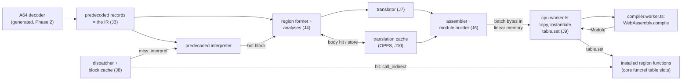
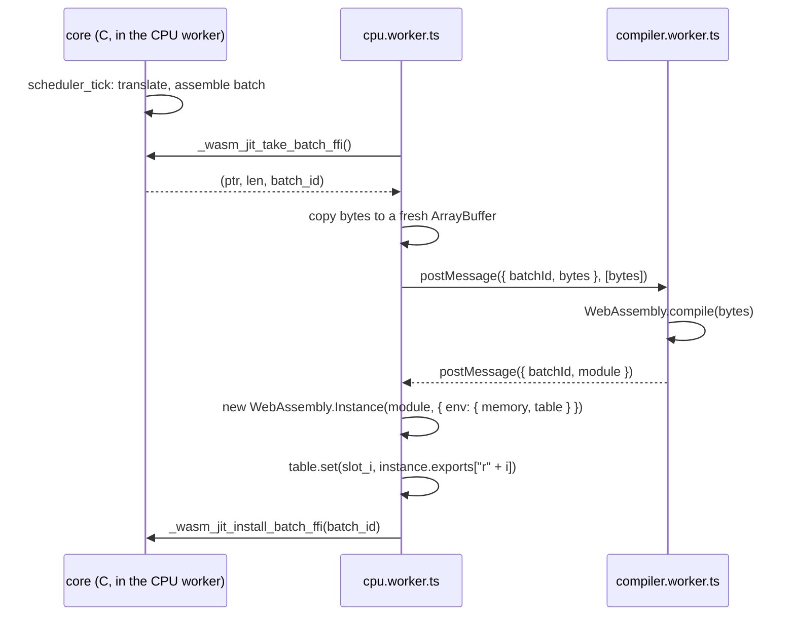

# wasm_jit — ARM64 → WebAssembly translator

Design specification for Voland's web JIT. It is the companion to [DESIGN.md](DESIGN.md) §10–§11, the way `GPU_COMMAND_STREAM.md` is to §13.

> **Status:** design v1 (October 2026), written ahead of implementation. `wasm_jit` is a Phase 5 deliverable (DESIGN.md §25). No `wasm_jit` code lands before Phase 5 opens, and every interface sketched in J15 goes through header review first (CLAUDE.md, "Interface headers gate implementation"). One part lands earlier: the A64 decoder and its record format (J3) arrive with the Phase 2 interpreter, which is why this document fixes their requirements now.
>
> **Precedence:** DESIGN.md is authoritative. A disagreement between the two documents is a bug in one of them, and the fix updates both in the same PR.
>
> **Verified so far:** the module mechanism this design rests on, probed on V8 (Node 26.5, 2026-10-27). A region module imports the core's shared memory64 and funcref table and is instantiated synchronously. The core calls it with `call_indirect`. It calls back into a core helper with `call_indirect`, and chains to another instance with `return_call_indirect`. Its `loop` + `br_table` body runs a million back edges at constant stack depth. A call to an empty table slot traps (J8.3). JSC and SpiderMonkey are covered by the J12 engine matrix.

**Contents:** J1 Scope · J2 Architecture · J3 The IR · J4 Regions · J5 Execution ABI · J6 Module shape · J7 Translation rules · J8 Dispatcher and code cache · J9 Web plumbing · J10 Translation cache · J11 Engine features · J12 Determinism and testing · J13 Performance and tiers · J14 Security · J15 Proposed interfaces · J16 Landing plan · J17 Open questions · J18 Decision log

---

## J1. Scope and fixed constraints

**What it translates.** Guest A64 code for the Switch 1 CPU (Cortex-A57): ARMv8.0-A with FP and Advanced SIMD, plus the CRC32 and Cryptographic Extensions (J17 question 1). Hint-space instructions from later architecture versions (PACIASP, AUTIASP, BTI, …) execute as NOPs, as they do on the A57. ARMv8.1+ instructions (LSE atomics, FP16 arithmetic, dot product) are undefined, as on hardware. They arrive with Switch 2 (J17 question 9).

**What it does not translate.** AArch32: 32-bit titles return `NOT_IMPLEMENTED` at bootstrap (the §12 bootstrap deviations, item 3, in DESIGN.md's v3.24 → v3.25 changelog). Native builds: they run the predecoded interpreter, and `wasm_jit` exists only in the web build (DESIGN.md §10, "Desktop: the WASM path is the web build").

**Inherited constraints.** These are fixed elsewhere and are not re-argued here:

| # | Constraint | Source |
|---|---|---|
| C1 | Region modules import the core's single shared memory and own none | DESIGN.md §4 |
| C2 | Every guest load and store translates through the page tables; no raw guest-address loads | §5, §10 req. 2 |
| C3 | Bounded execution: code stops when the budget expires; nothing runs to completion | §7, §8, §10 req. 1 |
| C4 | No function imports: regions import only the memory and the core's funcref table | §10 req. 5 |
| C5 | Exits return; they never trap (`unreachable`) for control flow | §10 req. 4 |
| C6 | Guest-visible results are bit-identical to the interpreter on every engine; host FP/SIMD is used only where proven exact | §1 goals, §3 |
| C7 | Green threads in one worker; single-threaded HLE; no host atomics for guest atomics | §7 |

**One new constraint, introduced here (J7.6):**

**C8. Determinism independent of compile timing.** For the same inputs, the interpreter and the JIT produce the same architectural state, the same cycle counts and the same preemption points, whichever regions happen to be compiled at the time. Compiles finish on wall-clock time, so any rule that lets "is this code compiled yet?" change guest-visible behavior makes runs irreproducible and defeats interpreter-vs-JIT differential testing (DESIGN.md §3). C8 is what makes §3's differential rule testable.

---

## J2. Architecture



| Layer | Location | Knows | Does not know |
|---|---|---|---|
| Decoder | `core/cpu/a64/decoder.{h,c}` (generated) | A64 encodings | execution, WASM |
| Records (the IR) | `core/cpu/a64/insn.h` | instruction forms, operand fields, per-form metadata | WASM |
| Thread state | `core/cpu/a64/state.h` | the per-thread layout both backends share (J5.1) | — |
| Predecoded interpreter | `core/cpu/backends/interpreter/` | A64 semantics in C | WASM |
| Dispatcher / code cache | `core/cpu/dispatch.{h,c}` | block cache, regions, slots, invalidation, hotness | A64 semantics, WASM encoding |
| Region former + analyses | `core/cpu/backends/wasm_jit/region.{h,c}` | region graphs, register and flag def/use | WASM encoding |
| Translator | `core/cpu/backends/wasm_jit/translate*.c` | A64 semantics as WASM operations | byte encoding |
| Assembler | `core/cpu/backends/wasm_jit/wasm_asm.h` | WASM opcodes, LEB128 | ARM |
| Module builder | `core/cpu/backends/wasm_jit/module.{h,c}` | sections, envelope, relocations | ARM semantics |
| Host glue | `platform/web/workers/{cpu,compiler}.worker.ts`, FFI in `core/stubs/` | compile, instantiate, `table.set`, OPFS | ARM, region contents |

The three WASM-side layers (assembler, module builder, translator) keep the 2026 draft's split (DESIGN.md §10): each one is tested without the others (J12).

**A region's life:**

1. The predecoded interpreter executes a block, and its entry counter reaches the hotness threshold (J4.7).
2. The region former grows a region from that block over predecoded records (J4).
3. The core hashes the region's code and looks it up in the translation cache (J10). On a miss, the translator lowers the region to a function body.
4. Bodies queue into a batch. The module builder assembles a module in the JIT emission buffer (J6.6).
5. Between scheduler ticks, `cpu.worker.ts` copies the batch out and posts it to the compiler worker, which returns a `WebAssembly.Module` (J9).
6. `cpu.worker.ts` instantiates it synchronously, `table.set`s each region function into the slot the core reserved for it, and tells the core the batch is live.
7. From the next lookup on, the dispatcher calls the region with `call_indirect` (J8.1). Until then, the interpreter ran the code.

---

## J3. The IR: predecoded A64 records

**Decision.** `wasm_jit`'s IR is the record format the predecoded interpreter executes: one fixed-size record per guest instruction, produced by the shared generated decoder, plus a static per-form metadata table. Regions (J4) are graphs of blocks of these records. There is no SSA, no micro-op layer, and no register allocator.

**Why this, and not a compiler IR:**

- **The browser already does the generic optimizations.** V8 (Liftoff, then TurboFan), JSC (BBQ, then OMG) and SpiderMonkey (baseline, then Ion) do register allocation, common-subexpression and dead-code elimination, constant folding and instruction selection on the WASM `wasm_jit` emits. A Voland SSA IR would do that work only for the engine to do it again.
- **The optimizations the browser cannot do need per-instruction facts, not an IR.** Which guest registers and flags an instruction reads and writes, whether it touches memory, whether it ends a block: these are static per instruction form, so they live in a generated table. They drive `wasm_jit`'s three ARM-aware optimizations: guest registers cached in locals (J7.1), lazy flags (J7.2), and the softmmu fast path (J7.3).
- **One decoder, two consumers.** The predecoded interpreter (DESIGN.md §25, Phase 5) needs exactly this format, and its block discovery and invalidation are the dispatcher's. Because the interpreter and the JIT consume the same records, the JIT can never decode differently from the interpreter, and interpreter-vs-JIT differential runs test lowering, not decoding. Decoder correctness is covered separately, by fuzzing the interpreter against an external reference (DESIGN.md §10, inherited ideas).
- **It stays small by construction:** a 16-byte record and a metadata table, which the interpreter needs anyway.

This reconciles the two positions recorded on the Ballistic decision. "No IR is required for WASM" holds for a generic compiler IR. "Decoder shared with the interpreter → small Voland IR → WASM emitter" holds for this one. The rejected alternatives are in J18.

**Record (sketch; header review with the Phase 2 decoder):**

```c
/* core/cpu/a64/insn.h — proposal */
typedef struct A64_Insn {
  uint16_t op;      /* A64_Op: one value per instruction form, e.g. A64_OP_ADD_IMM_X */
  uint8_t  rd, rn;  /* raw 5-bit register fields; what 31 means is in A64_Op_Info */
  uint8_t  rm, ra;
  uint16_t aux;     /* small form-specific fields: shift type/amount, extend,
                       condition, size; layout defined per form */
  uint64_t imm;     /* decoded immediate: bitmask immediates expanded, branch
                       offsets sign-extended, shifted forms pre-shifted */
} A64_Insn;         /* 16 bytes: four records per 64-byte cache line */
```

PC-relative fields stay offsets, never absolute addresses, so records are position-independent. The translation cache depends on that (J5.5, J10).

**Per-form metadata** (a generated `const` table indexed by `op`):

| Field | Meaning | Used by |
|---|---|---|
| `gpr_reads`, `gpr_writes` | which of rd/rn/rm/ra are sources and destinations, and for each whether 31 means SP or XZR | register caching (J7.1) |
| `flags_read`, `flags_written` | NZCV masks | lazy flags (J7.2) |
| `vreg_reads`, `vreg_writes` | V-register fields | FP/SIMD caching (J7.8) |
| `mem` | none, load, store, or load+store (exclusive); access size; element count; alignment requirement | softmmu lowering (J7.3), precise faults |
| `kind` | sequential, direct branch, conditional branch, call (BL), indirect, SVC, exception (BRK/UDF), system, barrier | block and region formation (J4) |
| `fp_mode_dependent` | the result depends on FPCR's mode bits | region specialization (J4.5) |
| `jit_tier` | 0 = interpreter only; 1 = translated by tier 1; and so on | coverage fallback (J4.6) |

**Requirement on the Phase 2 decoder**, fixed now so Phase 5 does not inherit a rewrite: it produces `A64_Insn` records with this metadata. Its generator works from ARM's machine-readable A64 specification (DESIGN.md §10); the license check is J17 question 2.

---

## J4. Regions

### J4.1 Terms

- **Guest block:** a maximal run of records ending at the first instruction whose `kind` is not sequential, or at a cap.
- **Region:** the compilation unit. One WASM function containing one or more guest blocks connected by direct branches.
- **Entry:** a block of a region that the dispatcher may call into. A region has one or more (J4.4).
- **Exit:** a point where control leaves the region (J5.4).

### J4.2 Formation

Starting from the hot block, the former adds blocks breadth-first by following:

1. both arms of conditional branches (B.cond, CBZ/CBNZ, TBZ/TBNZ) and the target of unconditional direct branches (B);
2. the fall-through of a BL, the return address. It is added as an **entry**, because control comes back to it through RET and the dispatcher.

A BL's target, the callee, is not followed in tier 1. A callee belongs to many callers, and inlining it needs return prediction (tier 2, J13).

The former reads guest code through vmm with execute permission (`vmm_translate_inline(..., VMM_PERM_X, ...)`). A fetch fault ends the block before the faulting instruction; executing that instruction later faults precisely, in the interpreter.

### J4.3 Terminators and caps

A block ends, and the region does not grow past it, at:

- an indirect branch (BR, BLR, RET), SVC, BRK, UDF, or any undefined encoding;
- YIELD, WFE or WFI, which always exit (J7.7);
- MSR FPCR, because the mode the region was built for may change (J4.5);
- an instruction whose `jit_tier` is above the translator's tier (J4.6);
- a debugger breakpoint address (DESIGN.md §23). Breakpoints are never inside a translated region.

Region caps are named constants whose initial values Phase 5 tunes: `WASM_JIT_MAX_REGION_BLOCKS` (64), `WASM_JIT_MAX_REGION_INSNS` (1024), `WASM_JIT_MAX_BODY_BYTES` (64 KB, DESIGN.md §11). When a cap stops growth, the unexplored successor becomes an exit.

**No exclusive-pair rule.** DESIGN.md §7's "region formation never splits an exclusive pair" is replaced by a semantic rule that holds for any region shape and for the interpreter: no preemption while the exclusive monitor is open (J7.6). Formation may still keep pairs together, for performance only.

### J4.4 Entries

A region may have several entries: the block it was formed from, BL fall-throughs, and blocks the dispatcher later finds hot that are already inside the region. The block cache maps each entry's GVA to `(slot, block index, page base)` (J8.2). Before each call the dispatcher writes the block index and page base into the thread context, and the region's body opens with a `br_table` on the index (J6.2). This avoids compiling a new, overlapping region for every BL return site.

Regions may still overlap in guest code: two regions can both contain block X. Invalidation drops every region whose source covers the affected range (J8.5).

### J4.5 Specialization key

A region is specialized on FPCR's mode bits: AHP, DN, FZ and RMode (bits 26:22; the A57 implements no FP trap enables and no FZ16). Only regions containing a `fp_mode_dependent` instruction carry a mode. Integer-only regions are mode-independent. The block cache key is `(GVA, mode)`, with mode "any" for integer-only regions (J8.2). MSR FPCR ends its region, so a region never runs under a mode it was not built for.

### J4.6 Coverage: untranslatable instructions

The translator does not need to cover the whole ISA at once. An instruction whose `jit_tier` is above the translator's tier ends the block before it. The region exits there, the dispatcher finds no region at that address, and the interpreter executes the instruction. The dispatcher records an interpret-only entry for the address, so it never tries to compile there again, and counts the fallback per `A64_Op`.

Two consequences:

- `wasm_jit` can land with partial coverage and grow form by form, each form tested on its own (J12).
- The fallback counters (debug builds and the trace buffer) show which forms cost the most interpreter time, so measurement decides what gets translated next.

### J4.7 Hotness

Regions are formed for hot code only. The predecoded interpreter keeps a saturating entry counter per block and requests a region when it reaches `WASM_JIT_HOT_THRESHOLD` (initially 8; tuned in Phase 5). DESIGN.md v3.27 §11 compiled on the first miss, which floods the compiler with boot code that runs once; the predecoded interpreter is fast enough that warming up costs little.

---

## J5. Execution ABI

### J5.1 Thread context

Region code addresses one per-thread structure, `A64_State`, which the interpreter and `wasm_jit` backends share. Its layout is fixed: emitted code uses `offsetof` values taken at core build time and pinned with `_Static_assert`s.

```c
/* core/cpu/a64/state.h — proposal */
typedef struct A64_Jit_Control {  /* one cache line, touched on every region call */
  int64_t  budget;       /* remaining cycles (J7.6) */
  uint32_t exit_reason;  /* A64_Exit; the dispatcher stores RESUME_DIRECT before each call */
  uint32_t entry_block;  /* region block index the dispatcher is entering (J4.4) */
  uint64_t page_base;    /* GVA base for position-independent code (J5.5) */
  uint64_t fault_gva;    /* valid when exit_reason == FAULT */
  uint32_t fault_info;   /* VMM_Fault_Kind | required perms << 8 */
  uint32_t svc_imm;      /* valid when exit_reason == SVC */
  uint32_t sync_pending; /* nonzero: IC IVAU queued invalidations (J8.5) */
  uint32_t monitor_open; /* exclusive monitor (J7.4) */
  uint64_t monitor_gva;
  uint64_t vt_base;      /* virtual time at run() entry, for CNTVCT (J7.7) */
} A64_Jit_Control;       /* exactly 64 bytes */

typedef struct A64_State {
  A64_Jit_Control   control;          /* offset 0 */
  CPU_Register_File regs;             /* DESIGN.md §8: x[31], sp, pc, pstate */
  _Alignas(16) uint8_t v[32][16];     /* V0-V31 */
  uint32_t fpcr, fpsr;
  uint64_t tpidr_el0, tpidrro_el0;
  _Alignas(16) uint8_t scratch[16];   /* helper result buffer (J7.9) */
  /* Backend-private fields follow; emitted code never addresses them. */
} A64_State;
```

`get_register_file` (DESIGN.md §8) returns `&state->regs`. States come from an arena in the core's low heap, where DESIGN.md §4 keeps hot host structures for memory64's sake.

### J5.2 Region function type

```wat
(func $region (param $ctx i64) (result i64))  ;; C: uint64_t (*)(A64_State *)
```

The parameter is the thread context and the result is the next guest PC. This refines the `() → i64` that requirement 5 named in v3.27 (DESIGN.md §10 now states the new type). Passing the context avoids loading a "current thread" global on every call, lets one translation serve every thread of the process (DESIGN.md §7), and leaves nothing to change for the per-core-worker experiment (J13).

The C dispatcher calls a region through an ordinary function pointer whose value is its table slot. On Emscripten, a C function pointer *is* an index into `__indirect_function_table`, so the call compiles to one `call_indirect` with no JS involved. Emscripten's own `addFunction` relies on the same mechanism.

### J5.3 Entry protocol

Before each call the dispatcher guarantees: `regs.pc` is the entry's GVA; `control.entry_block` and `control.page_base` come from the block-cache entry; `control.exit_reason` is RESUME_DIRECT; and `control.budget` is the remaining budget. The region's prologue loads the guest registers it uses (J7.1) and the page base, then dispatches on `entry_block`.

### J5.4 Exit protocol

Every exit does the same four things, in this order:

1. Write back every guest register the region writes (J7.1), and materialized NZCV into `regs.pstate` (J7.2).
2. Store the exit PC in `regs.pc` and the remaining budget in `control.budget`.
3. For any reason other than RESUME_DIRECT, store `control.exit_reason` and the fault or SVC details.
4. Return the exit PC.

Every exit leaves complete, consistent state in memory. So an exit can either return to the dispatcher (`return`, tier 1) or chain straight into another region (`return_call_indirect`, tier 2, J13) with nothing else changing.

| `A64_Exit` | Raised by | PC | Dispatcher action |
|---|---|---|---|
| RESUME_DIRECT | leaving the region by a direct branch or fall-through, a cap, an untranslatable instruction, MSR FPCR | target or next | look up and continue (not a check event, J7.6) |
| RESUME_INDIRECT | BR, BLR, RET | register value | check event, then look up and continue |
| BUDGET | a taken backward branch found the budget exhausted | branch target | return `CPU_EXIT_CYCLES_ELAPSED` |
| YIELD | YIELD, WFE or WFI retired | next | return `CPU_EXIT_CYCLES_ELAPSED` |
| SVC | SVC retired | next | invoke `svc_handler`, return `CPU_EXIT_SVC` |
| SYNC | ISB with invalidations pending | next | process invalidations, continue |
| FAULT | translation, permission or alignment fault | faulting instruction | return `CPU_EXIT_FAULT` with `fault_gva` |
| UNDEFINED | UDF, undefined encoding, EL0-inaccessible system register | the instruction | invoke the undefined handler, return `CPU_EXIT_FAULT` |
| BREAKPOINT | BRK | the instruction | invoke the breakpoint handler, return `CPU_EXIT_BREAKPOINT` |

Faults are **precise**. Guest state is exactly as it was before the faulting instruction, which has no architectural effect (J7.3), so a resumed thread simply re-executes it.

### J5.5 Position independence

Emitted code never embeds an absolute guest address. The dispatcher supplies `control.page_base`: the GVA of the region's base page, recorded in the block-cache entry as the entry's GVA minus the entry block's offset from that page. Every guest address the region produces is `$page_base + constant`: branch and exit targets, ADR and ADRP results, LDR-literal addresses, BL return addresses, and PCs written at exits.

This is what makes DESIGN.md §11's content-hash cache key correct. The key leaves out the GVA because ASLR and title updates move code. A body that embedded absolute addresses would compute wrong branch targets and ADRP pages when served at a new address. §11 assumed the property without stating it.

Page-aligned bases keep ADRP exact: `(page_base + off) & ~0xFFF == page_base + (off & ~0xFFF)`. Module images load at page-aligned addresses, and Voland's ASLR moves the code base in 2 MB granules (`address_space.{h,c}`, DESIGN.md §12 bootstrap), so code keeps its offsets within a page when it moves. The key still hashes each block's offset from the base page (J10), so two layouts that differ within a page never share a body.

Host-side constants differ in kind. The L1 page-table base, helper slot indices (J7.9) and, in tier 2, link slots are fixed for a session but not across builds. The translator emits each one as a fixed-width LEB128 immediate and records it in the body's relocation list. The module builder patches the immediates when it assembles a batch (J6.6). Cached bodies therefore contain neither guest addresses nor host addresses.

---

## J6. Module shape

### J6.1 Envelope

A module carries a batch of 1 to `WASM_JIT_MAX_BATCH` region functions:

| Section | Contents |
|---|---|
| Type | a canonical list in a fixed order: the region type `(i64) → i64` first, then the walk-helper type and the core helper types (J7.9). The fixed order keeps type indices identical across batches, so cached bodies need no type relocation. |
| Import | `env.memory`: `memory i64 shared`, minimum = maximum = the boot memory's page count (DESIGN.md §4, §10 req. 7). `env.table`: `table funcref`, minimum 0, no maximum, index type matching the core's table (J17 question 3). Nothing else (C4). |
| Function | one per region, plus the module-local walk helper (J7.3) |
| Export | each region function, named by batch position (`r0`, `r1`, …) |
| Code | the bodies (J6.2) |
| Custom `metadata.code.branch_hint` | unlikely hints on slow paths and exits (J11) |
| Custom `name` | debug builds: functions named after their entry GVA, so DevTools profiles show guest addresses. The builder writes this section per batch, so it never enters a cached body. |

### J6.2 Function body layout

```wat
(func $r (param $ctx i64) (result i64)
  ;; locals (J6.3); prologue: load touched guest registers, $page_base,
  ;; $budget; $sel = control.entry_block
  block $epilogue                    ;; the shared epilogue follows this block's end
    block $stub_sub64                ;; one block per lazy-flag kind an exit uses;
      block $stub_add32              ;;   each stub's code follows its block's end
        loop $dispatch
          block $B2
            block $B1
              block $B0
                local.get $sel
                br_table $B0 $B1 $B2 ;; taken only on entry and on back edges
              end
              ;; guest block 0
            end
            ;; guest block 1
          end
          ;; guest block 2 (the last block always ends in a branch or an exit)
        end
      end
      ;; stub: materialize ADD32 flags, then br $epilogue
    end
    ;; stub: materialize SUB64 flags, then fall into the epilogue
  end
  ;; epilogue: write back registers and NZCV, store pc, budget and reason, return $exit_pc
)
```

Three rules give the body its structure:

- **Forward edges are plain branches.** The code of guest block *k* follows the `end` of label `$Bk`, so a branch from block *i* to any later block *j* is `br $Bj`, and falling through to block *i*+1 needs nothing.
- **Back edges go through the selector.** A branch to an earlier block (or to itself) runs the budget check (J7.6), sets `$sel = j` and branches to `$dispatch`. The `br_table` at the loop head runs only on entries and back edges. Nested `loop`s for natural loops, which remove the table jump, are tier 2 (J13).
- **Exits leave the loop.** An exit site sets `$exit_pc` (plus the exit reason and fault details when needed) and branches out to the stub for the current lazy-flag kind, or straight to `$epilogue` when the flags are materialized.

The shape is the one DESIGN.md §11 settled: one function per region, so that guest loops never grow the WASM call stack.

### J6.3 Locals

Guest-value locals are all `i64`; width is a property of the operation (2026 draft). V registers are `v128`.

| Local | Type | Purpose |
|---|---|---|
| `$ctx` | i64 (parameter) | thread context |
| `$x0`…`$x30`, `$sp` | i64 | cached guest registers; only those the region touches |
| `$v0`…`$v31` | v128 | cached V registers; only those touched |
| `$n $z $c $v` | i32 | materialized flags |
| `$fa $fb $fr` | i64 | lazy-flag operands and result (J7.2) |
| `$sel` | i32 | block selector |
| `$budget` | i64 | remaining budget |
| `$page_base` | i64 | J5.5 |
| `$tlb_r_vpn $tlb_r_delta $tlb_w_vpn $tlb_w_delta` | i64 | one-entry TLB per direction (J7.3) |
| `$exit_pc`, `$exit_reason` | i64, i32 | set by exit sites |
| temporaries | i64, i32, f32, f64, v128 | a small pool the translator reuses across instructions |

That is at most about 110 locals plus temporaries, far under the JS API's limit of 50,000 locals per function (the 2026 draft's stated cap stays stated).

### J6.4 Exit stubs and the epilogue

Each region has one **shared epilogue** that performs J5.4's four steps. It can write back the whole written-register set from any exit because of J7.1's invariant: every cached register's local holds the architectural value at every point. An exit site therefore costs a few `local.set`s and a `br`. That matters because exits are numerous and cold: every memory access has a fault exit (J7.3).

The flags are the one thing that differs between exit sites, because they may be lazy (J7.2). The region gets one **materialization stub** for each lazy-flag kind that any of its exits uses: at most about ten (add, sub, adc, sbc and logic, each in 32 and 64 bits). A stub turns `$fa $fb $fr` into `$n $z $c $v` and falls into the epilogue. Code size grows with the number of kinds, not with the number of exits.

### J6.5 Encoding rules

Carried forward from the 2026 WASM backend draft (DESIGN.md §10):

- **Three layers.** The assembler emits bytes and knows nothing of ARM. The module builder handles sections and knows nothing of ARM semantics. The translator implements ARM semantics and knows nothing of byte encoding.
- **Hot-path emission contract.** Fixed-opcode emitters are `static inline` with no per-call checks. The translator reserves worst-case bytes once per guest instruction and checks status once per instruction. LEB128 helpers are out of line.
- **Forward size fields** (each function body's size, then the code section's size) are 5-byte padded LEB128, patched after emission. Nothing is shifted. Relocated immediates (J5.5) are fixed-width for the same reason.
- **Alignment hints:** `align=0` for guest accesses, because ARM64 permits unaligned access to normal memory. Context accesses use natural alignment, which they have by construction.

### J6.6 Batching

The unit of **translation and caching** is a region's function body, with its metadata: entries and their offsets, relocations, branch-hint offsets, and source ranges. The unit of **compilation** is a batch module that the builder assembles from bodies. Assembly is concatenation plus relocation patching; it involves no translation.

Batching spreads the per-module compile and instantiate overhead. A batch is flushed when it holds `WASM_JIT_MAX_BATCH` bodies (initially 16) or when a scheduler tick ends with bodies queued, so batching never adds more than one tick of latency. Invalidation stays per region: it resets that region's slot, and the instance is garbage-collected once none of its slots refer to it.

---

## J7. Translation rules

### J7.1 General-purpose registers

- **Caching.** Every guest register the region reads or writes lives in a local for the whole region. The prologue loads each touched register with one `i64.load` from `regs`; the epilogue stores each written one. Invariant: every cached local holds its register's architectural value at every program point, which is what lets all exits share one epilogue (J6.4). Loading only each entry's live-in registers, and writing back per-exit sets, are tier-2 refinements (J13).
- **Register 31.** As the record metadata says, a read of XZR is `i64.const 0` and a write to XZR is dropped. Side effects still happen; CMP is SUBS to XZR and still sets flags. SP accesses use `$sp`.
- **32-bit forms** lower as `i32.wrap_i64` on each source, the `i32` operation, then `i64.extend_i32_u`. That zero-extension *is* ARM's rule that a W write clears the upper half of the X register. Sign extension happens only where the instruction asks for it.
- **ARM-defined edge results**, all branch-free:
  - **SDIV/UDIV** (2026 draft): `d' = (d == 0) ? 1 : d`, and for signed division also `d' = (n == INT_MIN && d == −1) ? 1 : d'`; then `q = n / d'` and `result = (d == 0) ? 0 : q`, all with `select`. ARM defines a zero result for division by zero, and `INT_MIN / −1 = INT_MIN`; WASM traps on both.
  - **Variable shifts** (LSLV, LSRV, ASRV, RORV): WASM shifts already reduce the count modulo the width, which is exactly ARM's rule.
  - **SMULH/UMULH:** `i64.mul_wide_s/u` where wide arithmetic is available (J11), otherwise four 32×32 partial products.
  - **Bitfield moves** (UBFM, SBFM, BFM, EXTR): one general lowering, plus fast paths for the aliases the decoder identifies (LSL, LSR, ASR, ROR, UXT*, SXT*). This answers the 2026 draft's question Q-B without an IR.

### J7.2 Condition flags

**Lazy flags.** At each point, the translator knows whether NZCV is *materialized*, in `$n $z $c $v`, or *lazy*: a static kind (ADD, SUB, ADC, SBC or LOGIC, in 32 or 64 bits) whose operands and result are in `$fa $fb $fr`. A flag-setting instruction only copies its operands and result into those locals, which the engine's register allocator usually makes free.

- **Conditions** (B.cond, CSEL, CSINC, CSET, and the rest) are evaluated directly from the lazy form where the kind allows it. After SUB, `EQ` is `$fa == $fb`, `HI` is `$fa >u $fb` and `GE` is `$fa >=s $fb`, so a CMP + B.cond pair becomes one host compare and branch. Otherwise the consumer materializes first.
- **Carry consumers** (ADC, SBC, ADCS, SBCS) take C from the lazy form; after SUB, C is `$fa >=u $fb`.
- **Materialization** happens at: MRS NZCV; CCMP and CCMN, whose result merges two flag states; the end of a block whose in-region successor has more than one predecessor, if the flags are live into it; and every exit, through the stub for the current kind (J6.4).
- **Liveness.** A backward pass over the region's blocks finds where the flags are live at block starts. Exits count as reads, because the next region may read the flags. A dead flag-setter leaves its operands in the lazy locals, which costs nothing, and is never materialized.
- **Overflow (V)** for ADDS/SUBS comes from the high word of a 128-bit add or subtract where wide arithmetic is available. Otherwise it is `((a ^ r) & (b ^ r)) >> 63` for addition and `((a ^ b) & (a ^ r)) >> 63` for subtraction.

### J7.3 Memory access

**Fast path.** Each direction, read and write, keeps a one-entry TLB in locals: a guest page number and `delta = host page − guest page`.

```
vpn = addr >> 12
if (vpn == tlb_vpn && (addr & 0xFFF) <= PAGE_SIZE − size)   ;; one-byte accesses skip the second test
    host = addr + tlb_delta
else
    slow path                                                ;; unlikely hint
```

`tlb_vpn` starts as all ones, which no 64-bit address's page number can equal, so an unfilled entry never hits. (A single unsigned compare of `addr − tlb_page` is shorter but unsound: whatever value marks "empty", some 4096 guest addresses would hit it.) The TLB locals need no invalidation: page tables change only in SVC handlers and the dispatcher, never while a region runs (green threading, DESIGN.md §7). This mirrors the interpreter's one-entry TLB per direction (DESIGN.md §5). A TLB that survives across region calls is §5's measured software TLB, in tier 2.

**Slow path.**

- An access that crosses a page boundary (`(addr & 0xFFF) > PAGE_SIZE − size`) calls a core helper (J7.9) wrapping `vmm_read_cross_page` / `vmm_write_cross_page`. They validate both pages before moving a byte; read results come back through `scratch`.
- Any other miss calls the module-local walk helper, `$walk(addr, perms) → delta or fault code`. It performs DESIGN.md §5's two-load walk against the L1 base (a relocated constant) and checks `(pte & perms) == perms`. A delta is page-aligned, so a fault comes back as a value with nonzero low bits that carry the `VMM_Fault_Kind`. On success the caller refills its TLB entry. The walk is not inlined at each access site; that would multiply code size for a cold path.
- A fault exits with reason FAULT, the fault details, and `$exit_pc` set to the instruction, then goes through the stub or epilogue. At that point the instruction has changed no register, flag or memory.

**Multi-access instructions are all-or-nothing.** LDP/STP, LD1–LD4/ST1–ST4 and DC ZVA translate their whole byte range (as one access when it lies within one page) before any register write or store. Writeback addressing (pre- and post-index) updates the base register only after the access succeeds. Together these make every fault precise.

**Alignment.** Guest accesses use `align=0`. Exclusives, LDAR/STLR and LDAXP/STLXP require natural alignment on ARMv8.0; a misaligned one is a FAULT. PRFM is a NOP and never faults. DC ZVA zeroes the aligned 64-byte block (DCZID_EL0 reports 64 bytes).

### J7.4 Exclusives, atomics, barriers

Under green threading (DESIGN.md §7), nothing else runs between two guest instructions of a thread except at exits. So:

- **The exclusive monitor** lives in `control.monitor_open` and `control.monitor_gva`. It is kept in memory rather than locals because exclusives are rare and the state must survive region-to-region transitions within one `run()`. LDXR, LDAXR and the pair forms load, then open the monitor on the address. STXR and STLXR succeed if and only if the monitor is open on the same address; either way the monitor closes, and the status register receives 0 on success or 1 on failure. CLREX closes it. `run()` entry closes it, which is DESIGN.md §7's "cleared on every context switch". The store itself is a plain store. The interpreter implements these same rules; they are defined once.
- **No host atomics.** Guest atomics need none (§7). The GPU worker does write guest RAM concurrently (NVDEC output, DESIGN.md §13), but only buffers the guest reads after waiting on a syncpoint, and the syncpoint already orders the accesses. Racing non-atomic WASM accesses are well-defined, though nondeterministic, and never undefined behavior.
- **Barriers.** DMB and DSB are NOPs, because one host thread executes all guest threads in program order. ISB is a NOP unless `control.sync_pending` is set, in which case it exits with SYNC (J8.5).
- The per-core-worker fork (DESIGN.md §7) would replace all three: `cmpxchg` with a value check for STXR, real atomics, real fences.

### J7.5 Control flow

| Guest | Lowering |
|---|---|
| B, B.cond, CBZ/CBNZ, TBZ/TBNZ to a block in the region | forward: `br $Bj`. Backward: budget check (J7.6), then `$sel = j; br $dispatch`. |
| The same, to a block outside the region | exit RESUME_DIRECT. A backward one checks the budget first and exits BUDGET instead if it is exhausted. |
| BL | `$x30 = $page_base + offset(BL) + 4`, then as B to the callee: always an exit in tier 1 |
| BR, BLR, RET | BLR sets `$x30` first; exit RESUME_INDIRECT with the register's value as the PC |
| SVC #imm | `svc_imm = imm`; exit SVC with PC = next |
| BRK | exit BREAKPOINT with PC = this instruction |
| UDF, undefined encodings | exit UNDEFINED with PC = this instruction |

Tier 1 sends every indirect branch through the dispatcher. Return prediction and inter-region linking are tier 2 (J13).

### J7.6 Budget, preemption and cycle accounting

**Cycle accounting.** Both backends charge one cycle per retired guest instruction. An instruction retires when it completes. A faulting instruction does not retire; SVC does.

**Check events (C8).** A thread's budget is examined only when one of these retires:

1. a taken direct branch whose target is at or below its own address (a backward branch, including a branch to itself);
2. an indirect branch (BR, BLR, RET).

If the budget is ≤ 0 at a check event, the thread is preempted with its PC at the branch target, before the target executes. Nothing else preempts: not block entries, not region boundaries, not caps, not compile state. Check events are properties of the guest program alone, so the interpreter and the JIT preempt at exactly the same dynamic points, and so do two runs that compiled different regions at different times.

Every infinite execution passes check events infinitely often. A path made only of forward direct branches and fall-throughs strictly increases the PC, so it is finite. The budget can therefore overshoot by at most the longest forward-only path, and it overshoots by the same amount in both backends.

**Exclusive windows.** A check event is skipped while the monitor is open, so preemption never lands between LDXR and STXR. That is DESIGN.md §7's livelock guard, layer 1, now independent of region shape. A grace cap bounds it: once the budget is below `−EXCLUSIVE_GRACE_CYCLES` with the monitor still open, the next check event preempts anyway and closes the monitor. That is layer 2's instruction cap, defined once for both backends.

**In the JIT.** Each block subtracts its instruction count from `$budget` on entry, a register decrement. Backward edges and indirect exits test `$budget ≤ 0`; the monitor is consulted only when that test passes, which is rare. A mid-block exit (fault, SVC, cap) adds back the cost of the block's unretired instructions, a constant per exit site. `control.budget` therefore always equals the initial budget minus the retired instructions.

This refines DESIGN.md §7's "a per-block cycle-counter decrement and check at block entry". §7 is updated to match.

### J7.7 System registers and hints

| Instruction | Lowering |
|---|---|
| MRS/MSR TPIDR_EL0; MRS TPIDRRO_EL0 | context load or store (TPIDRRO_EL0 is read-only at EL0) |
| MRS/MSR NZCV | materialize, or set the flag locals |
| MRS FPCR / MSR FPCR | context load / store, then exit RESUME_DIRECT (J4.5) |
| MRS/MSR FPSR | context load or store (cumulative exception bits: J7.8) |
| MRS CNTVCT_EL0, CNTPCT_EL0 | virtual time: `vt_base` plus the instructions retired so far, converted to counter ticks by the scheduler's formula (DESIGN.md §7). One shared C definition serves both backends; the JIT derives the retired count from `$budget` and the instruction's position in its block. |
| MRS CNTFRQ_EL0, CTR_EL0, DCZID_EL0 | Cortex-A57 constants from one shared header |
| DC ZVA | J7.3 |
| DC CVAU, CIVAC, CVAC; IC IVAU | NOPs for memory. IC IVAU also calls a helper that queues an invalidation (J8.5). |
| ISB | J7.4 |
| YIELD, WFE, WFI | exit YIELD: the thread gives up the rest of its slice. Spin-wait loops use these, so the thread being waited on runs sooner. WFE may wake spuriously, so this is architecturally allowed, and it is deterministic. |
| NOP, SEV, SEVL, hint-space PAC and BTI | NOP |
| any system register that EL0 cannot access on hardware | exit UNDEFINED |

### J7.8 Floating point and SIMD

The rule is DESIGN.md §3's: core owns FP and vector semantics, and host FP/SIMD is used only where it is bit-exact. WASM arithmetic is IEEE 754 round-to-nearest-even. That matches ARM's default mode for add, subtract, multiply, divide, square root and integer↔FP conversion, **except for NaNs**: WASM leaves NaN payloads nondeterministic.

- **NaN fixup.** After every arithmetic result that can be a NaN, an unlikely-hinted `x == x` test guards a branch-free sequence that recomputes ARM's NaN. It quiets the first signaling-NaN operand, else returns the first quiet-NaN operand, else returns the default NaN; FPCR.DN = 1 forces the default NaN. The operand order is the ARM pseudocode's (`FPProcessNaNs`, `FPProcessNaNs3`, including FMA's addend-first order). The common path costs one compare.
- **Exact by construction:** FNEG, FABS, FMOV and other bit moves (WASM's `neg`, `abs` and `copysign` are bitwise); FCVTZS/FCVTZU (WASM's `trunc_sat` saturates and maps NaN to 0, exactly as ARM does); FRINTN, FRINTZ, FRINTP and FRINTM (`nearest`, `trunc`, `ceil`, `floor`); FMAX and FMIN, because WASM's `max` and `min` already order signed zeros as ARM does (`max(−0, +0) = +0`, `min(−0, +0) = −0`). Only their NaN payloads need the fixup.
- **Emulated:** FMAXNM/FMINNM (IEEE maxNum semantics); FCVTAS, FCVTAU and FRINTA (ties away from zero); FCVT to and from half precision; FRECPE, FRSQRTE and FRECPX (ARM's defined estimate tables); fused multiply-add.
- **Fused multiply-add** (FMADD, FMSUB, FNMADD, FNMSUB, FMLA, FMLS, FRECPS, FRSQRTS) must be fused: ARM always fuses, and baseline WASM has no fused operation. Tier 1 computes it exactly. f32 lanes are computed in f64, where the product of two f32 values is exact, with round-to-odd emulation of the f64 addition so the final rounding to f32 cannot double-round. f64 goes through a core helper (J7.9). `relaxed_madd` is not used (J11).
- **FPCR modes.** Regions are specialized on the mode (J4.5). FZ = 1 adds input and output flushing around each operation. DN = 1 reduces the NaN fixup to the default NaN. A rounding mode other than round-to-nearest has no WASM equivalent. Tier 1 treats FP instructions as untranslatable under such a mode (J4.6), and the interpreter's software rounding handles them; games rarely leave round-to-nearest.
- **FPSR cumulative exception flags** (IOC, DZC, OFC, UFC, IXC, IDC) are not computed, by either backend, so differential runs agree. QC (saturation) is computed for saturating integer SIMD instructions, where it is cheap. J17 question 7 asks the maintainer to accept this as a documented, guest-observable divergence.
- **NEON.** V registers are `v128` locals. Integer lane operations map to WASM SIMD where the semantics match exactly. These include add, subtract, multiply, logic, compare, min and max, and shifts by an immediate; `add_sat`/`sub_sat` for 8- and 16-bit lanes; `popcnt`, `extmul` and `narrow`; `swizzle` for single-register TBL; and `shuffle` for ZIP, UZP, TRN and EXT. Everything else is emulated per lane, or left to the interpreter (J4.6) until measurement promotes it. Scalar FP works on lane 0 and zeroes the upper lanes on write, as ARM does. Tier 1 targets the forms compilers emit most often in game code: moves and inserts, structure loads and stores (LD1–LD4, ST1–ST4), vector FP arithmetic and FMLA, conversions and shuffles. The fallback counters guide the order.

### J7.9 Helper calls into the core

Some operations are better done by C in the core: page-crossing accesses, f64 FMA, the estimate tables, CRC32, half-precision conversion, and IC IVAU's queueing. Region code calls them with `call_indirect` through the imported table, at the helper's own slot in `__indirect_function_table`; on Emscripten a C function's address is that slot index. This is not a function import, so C4 holds: no JS is involved and the import section does not change.

Rules:

- Helper slot indices are relocated constants (J5.5).
- Each helper's C prototype maps to exactly one entry of the canonical type list (J6.1). A mismatch is a signature trap at the call, so every helper has a test that calls it from an emitted module.
- Helpers take `A64_State *` when they need context. They never change vmm mappings, never touch the scheduler, and never call region code.
- A helper reports a fault by writing the `control.fault_*` fields and returning a sentinel. The calling region performs the exit, because only it can write back its cached registers.

---

## J8. Dispatcher and code cache

`core/cpu/dispatch.{h,c}` is backend-agnostic. The predecoded interpreter uses it on its own, and `wasm_jit` adds regions and table slots.

### J8.1 run()

```
run(state, budget):
    close the exclusive monitor                    ; context switch (DESIGN.md §7)
    control.budget = budget; control.vt_base = scheduler time
    loop:
        if control.sync_pending: process invalidations (J8.5)
        e = block_cache_lookup(regs.pc, fpcr mode)
        if e is a region entry:
            control.entry_block = e.block; control.page_base = e.page_base
            control.exit_reason = RESUME_DIRECT
            call e.slot(state)                     ; one call_indirect (J5.2)
            reason = control.exit_reason
        else:
            reason = interpret(state)              ; predecoded; stops at an event or at a block
                                                   ; that has a region; counts hotness (J4.7)
        switch reason:
            RESUME_DIRECT, SYNC: continue
            RESUME_INDIRECT:     if budget <= 0 and (monitor closed or past grace): return CYCLES_ELAPSED
                                 continue
            BUDGET, YIELD:       return CYCLES_ELAPSED
            SVC:                 svc_handler(state, control.svc_imm); return SVC
            FAULT:               return FAULT
            UNDEFINED:           undefined_handler(...); return FAULT
            BREAKPOINT:          breakpoint_handler(...); return BREAKPOINT
    cycles consumed = budget − control.budget
```

The interpreter raises the same reasons at the same events (C8). A write to translated code no longer arrives as a fault (J8.5).

### J8.2 Block cache

An open-addressing hash table from `(GVA, mode)` to an entry, allocated once from an arena (no `malloc`, CLAUDE.md rule 4). Entry kinds: region entry (slot, block index, page base, region id), predecoded block, interpret-only (J4.6), and compile pending. Mode-independent regions are stored under mode "any" and found by a second probe. GVAs live only here, never in the translation cache (DESIGN.md §11).

Region records, also from an arena, hold: the slot, the entries, the source ranges as both GVA ranges and guest-physical pages (J8.5), the batch id, and the state (pending, live or dead).

### J8.3 Table slots

- At boot, `cpu.worker.ts` grows the core's table once, by `WASM_JIT_SLOT_CAPACITY` slots (initially 65,536; the JS API allows 10,000,000 entries). It fills every new slot with the **unlinked trampoline**, a core C function of the region type that sets RESUME_DIRECT and returns `regs.pc`. Growing the table needs `-sALLOW_TABLE_GROWTH=1`; that DESIGN.md §24 change lands with the backend (J17 question 3). The table never grows during play, mirroring the rule that memory size is fixed at boot.
- The core allocates slots from a freelist. Every slot always holds a callable function of the region type, either a live region or the trampoline, because a call to an empty slot traps (verified, see Status). In tier 1 a block-cache entry and its slot are always reset together (J8.5), so the dispatcher never reaches the trampoline through a live entry. If it does, that is a bug: debug builds assert, and release builds evict the entry and interpret rather than loop. In tier 2 the trampoline is also the legitimate target of a link slot whose region is not installed yet.
- When the freelist runs out, tier 1 flushes the whole code cache, resetting every slot to the trampoline, and lets hot code recompile. Measured LRU eviction is tier 2.

### J8.4 Compile pipeline and installation

The compile hand-off is a pull interface. The core never calls into JS for it, so `core/` stays platform-agnostic and the FFI layer in `core/stubs/` is the only Emscripten-specific code.

1. The dispatcher queues region requests. Translation runs in the CPU worker inside `scheduler_tick`, with a per-tick bound so it never stalls emulation.
2. The module builder writes a batch into the JIT emission buffer (a DESIGN.md §4 layout region).
3. After `scheduler_tick` returns, `cpu.worker.ts` calls `_wasm_jit_take_batch_ffi()` and receives `(ptr, len, batch_id)`. It copies the bytes into a fresh `ArrayBuffer` and posts it, transferred, to the compiler worker. The copy is required because the core reuses the emission buffer for the next batch while compilation is in flight. At most `WASM_JIT_MAX_INFLIGHT_BATCHES` (initially 4) are outstanding.
4. The compiler worker calls `WebAssembly.compile` and posts the Module back. That is legal because both workers are in the same agent cluster (DESIGN.md §11).
5. `cpu.worker.ts` instantiates the module synchronously with `{ env: { memory, table } }`, `table.set`s each export into its reserved slot, and calls `_wasm_jit_install_batch_ffi(batch_id)`. The core marks the regions live and registers their entries in the block cache. If an invalidation killed a region while its batch was in flight, that region's slot goes straight back to the trampoline.

### J8.5 Invalidation

**Decision: no write-protection.** DESIGN.md §5 planned to write-protect pages holding translated code and catch the write fault. That plan is replaced, for three reasons:

- vmm's `QueryMemory` answers from the PTE permission bits, so a W bit cleared by the JIT would be visible to the guest: a §3 leak.
- Horizon enforces W^X for applications. Code is mapped RX and cannot be written at its executable address. The only writable code is CodeMemory, which writes through a separate RW alias, so a write never goes through the executable mapping anyway.
- Guest code that writes code must, architecturally, follow the write with IC IVAU and a context-synchronizing event (ISB, or an exception return) before executing it, or real hardware may run stale instructions.

So translations are invalidated by the events that signal a change architecturally:

| Source | Mechanism | Granularity |
|---|---|---|
| Mapping change: `vmm_unmap`, `vmm_reprotect`, `vmm_map` | vmm mutation observer → `dispatch_invalidate_va(range)` (new vmm hook, J15) | GVA range |
| Guest IC IVAU | a helper queues the guest-physical page of the line and sets `sync_pending`. The queue is processed at the next ISB (exit SYNC), the next `run()` exit, or `run()` entry. | guest-physical page, so a write through a CodeMemory RW alias invalidates translations made from its RX alias |
| HLE loading code (ro:, later loaders) | always followed by a mapping change | GVA range |
| Debugger breakpoint set or cleared | explicit call | GVA |
| `CPU_Backend.invalidate_cache` / `clear_cache` (DESIGN.md §8) | explicit call | GVA range / everything |

Invalidation drops predecoded blocks and regions alike, because they share one cache. It resets dead regions' slots to the trampoline and removes their block-cache entries. It runs only in the dispatcher between region calls, so no region is invalidated while it executes. A region that invalidates itself (IC IVAU followed by ISB inside the same region) exits at the ISB before the dispatcher drops it.

**Reserved fallback.** A title that modifies code without IC IVAU is possible in homebrew; Horizon-legal titles cannot. If one turns up, the fallback is a software PTE bit, `VMM_PTE_WRITE_WATCH` (bit 3), set on writable pages that have translations. The store fast path's permission test becomes `(pte & (W | WRITE_WATCH)) == W`, the same number of instructions as today, and a hit exits before the store. The fallback is specified here so it never has to be invented under pressure; tier 1 does not build it.

### J8.6 Single-writer invariant

Unchanged from DESIGN.md §11. Every block-cache and table mutation (installation, slot reset, invalidation) happens on the CPU worker thread, between scheduler ticks. Adding a second mutator inherits the §7 fork price.

---

## J9. Web plumbing



This replaces DESIGN.md §16's CPU↔compiler message types:

```typescript
type CPUToCompilerMessage = {
  readonly batchId: number;
  readonly bytes:   ArrayBuffer;   // transferred: a copy of one batch module
};
type CompilerToCPUMessage =
  | { readonly batchId: number; readonly module: WebAssembly.Module }
  | { readonly batchId: number; readonly error:  string };
```

Cache keys no longer travel in these messages. The translation cache stores bodies, which the core assembles itself (J10), so the compiler worker only ever sees finished modules and keeps no state.

**Failure handling.** A compile error means the translator emitted an invalid module, so it is always a translator bug. `cpu.worker.ts` calls `_wasm_jit_fail_batch_ffi(batch_id)`, and the core marks the batch's entries interpret-only, frees the slots and emits a `TRACE_JIT_COMPILE_FAILED` event. Debug builds also save the module bytes to OPFS for reproduction, and can run `WebAssembly.validate` before posting to fail early with a precise log. Emulation continues on the interpreter.

**CSP.** Compiling generated bytes needs no CSP allowance today, because Voland's CSP (DESIGN.md §16) has no `script-src`. Any future `script-src` must include `'wasm-unsafe-eval'`. Without it the JIT would stop compiling while the interpreter kept running: a silent performance cliff.

---

## J10. Translation cache (PTC)

DESIGN.md §11 and §15 already fix the storage (OPFS for bytes, IndexedDB for metadata, local only per §1.6) and the main facts: the cache holds bytes, not modules, and saves translation cost, not compile cost. `wasm_jit` settles the rest.

- **Unit:** one region body plus its metadata (entries and their offsets, relocations, branch-hint offsets, source-range sizes), not a module. A warm start assembles cached bodies into batch modules without translating anything.
- **Key:** `hash(for each block in region order: its offset from the base page ‖ its code bytes) ‖ entry offsets ‖ mode ‖ ir_build_id ‖ backend_version ‖ engine_features`, namespaced by titleId. The key contains no GVA, because bodies are position-independent (J5.5). It contains no core build id, because relocations make bodies independent of host addresses.
- `engine_features` is the bitset of feature-detected emission paths the body uses (J11). Bytes that use wide arithmetic must never be served to an engine without it.
- `ir_build_id` changes whenever emitted code changes for the same input; in practice, whenever a golden emission test changes (J12).
- **Lookup comes after region formation.** Forming a region and hashing its code is cheap compared with translating it, and only the formed region knows its exact bytes. A hit skips translation. A miss translates, and stores the body once its batch is installed.
- **Access path.** The core reaches the cache through two synchronous callbacks in `Wasm_Jit_Config`: read a body by key, and append a body. The web FFI layer implements them over an OPFS sync access handle that the CPU worker opens when a title starts (DESIGN.md §15). The key index is loaded into an arena at the same moment. `core/` sees only function pointers.
- **AOT pre-translation** (Phase 7) fills this cache in advance from known entry points. Nothing about it changes the format.

---

## J11. Engine features

`wasm_jit` targets baseline WebAssembly 3.0, which includes the memory64 and tail-call support every browser Voland runs on already ships (DESIGN.md §4, §16), plus the shared-memory atomics proposal. Beyond that, as of October 2026:

| Feature | Use | Detection | In cache key |
|---|---|---|---|
| Branch hinting (`metadata.code.branch_hint`) | slow paths, faults, budget and other exits marked unlikely | none: engines without support ignore the section | no |
| Wide arithmetic (`i64.mul_wide_s/u`, `i64.add128`, `i64.sub128`) | SMULH/UMULH; carry and overflow flags | `WebAssembly.validate` on a probe module at boot, with a baseline fallback | yes |
| Tail calls (`return_call_indirect`) | tier-2 inter-region linking (J13); not used in tier 1 | none needed: part of WASM 3.0, shipped with memory64 everywhere | — |
| Relaxed SIMD | not used for anything ARM defines exactly: `relaxed_madd` may or may not fuse, depending on the host | — | — |
| JSPI | not needed: nothing in Voland blocks inside WASM (DESIGN.md §7) | — | — |
| JIT interface proposal (WebAssembly/jit-interface) | watch item; until it ships, late linking (memory and table imports) is the standard technique | — | — |

`relaxed_madd` could replace tier 1's exact FMA emulation on engines where it always fuses. That needs evidence first: that the specification fixes the choice for a given engine and host rather than per call site or per compiler tier, plus a boot-time probe and a cache-key bit. It is J17 question 5.

---

## J12. Determinism and testing

C8 makes the interpreter and `wasm_jit` observationally identical: the same registers and memory, the same cycle counts, the same preemption points, the same CNTVCT values and the same fault reports. Every layer below is tested against that.

| Layer | Test | Runs on |
|---|---|---|
| Assembler | golden bytes per emitter | native ctest |
| Module builder | assembled modules pass `WebAssembly.validate`; relocation patching round-trips | native build emits, Node validates (no Wasmtime or wasm-tools dependency) |
| Region former, analyses | region shapes (loops, diamonds, multiple entries, caps), flag liveness, register sets: asserted on structure, no WASM involved | native ctest |
| Translator | **data-driven instruction vectors** (encoding, pre-state, post-state; CLAUDE.md), each run through both the interpreter and `wasm_jit` | the core's web build under Node (shared memory64) |
| Exits | budget expiry at exact counts; fault precision (a fault at instruction k leaves the state after k−1); exclusive windows and the grace cap; IC IVAU + ISB self-invalidation; mapping-change invalidation | Node |
| Differential fuzzing | random instruction sequences from the decoder's encoding space, and whole regions: interpreter vs `wasm_jit`, compared at every exit | Node, nightly |
| Engine matrix | the vector suite on V8, JSC and SpiderMonkey (Playwright WebKit and Firefox), proving the NaN fixups and FP emulation exact everywhere | CI, periodic |
| End to end | homebrew NROs (DESIGN.md §25 Phase 2's proof of life): interpreter and JIT runs must produce the same hashes | headless Chrome e2e |

The interpreter-vs-JIT differential cannot see decoder bugs, because both sides consume the same records. The decoder is covered by fuzzing the interpreter against an external reference (DESIGN.md §10, inherited ideas), which lands with the Phase 2 interpreter.

**Debug aids:** a switch that disables the JIT globally; a per-GVA-range disable for bisecting; the fallback counters (J4.6); `name` sections for profiling; and trace events `TRACE_JIT_REGION_FORMED`, `TRACE_JIT_COMPILED`, `TRACE_JIT_INSTALLED`, `TRACE_JIT_INVALIDATED` and `TRACE_JIT_COMPILE_FAILED`.

---

## J13. Performance model and tiers

**Where tier 1's time goes, by design:**

- **Inside a region**, guest registers and flags end up in host registers once the engine's optimizing tier runs. A memory access that hits the TLB costs a handful of host instructions plus memory64's bounds check (DESIGN.md §4).
- **Region transitions** cost a write-back of the written registers, a return, a hash probe, a `call_indirect`, and reloading the touched registers. This is tier 1's main overhead on branchy, call-heavy code.
- **Cold code** runs in the engine's baseline tier until the engine promotes it. Regions are hot by construction (J4.7), so promotion comes quickly.

**Tier-1 exit criteria**, measured in Phase 5: every translated form passes the vector suite on all three engines, and `wasm_jit` runs an integer homebrew benchmark set at least 3× faster than the predecoded interpreter. The 3× figure is a starting point for the maintainer to adjust.

**Tier 2.** Each item ships only when profiling shows its cost:

| Optimization | What it removes |
|---|---|
| Inter-region linking: a static exit does `return_call_indirect` on the target's link slot, which holds the trampoline until the target is installed | the dispatcher round trip on direct transfers between regions |
| Return prediction: a small return-address stack in the context; RET compares against the top and chains on a match | the hash probe on returns |
| Natural loops emitted as nested `loop`s (a stackifier) | the `br_table` jump on back edges |
| Per-entry live-in loads and per-exit write-back sets | unneeded loads and stores at transitions |
| Persistent software TLB in the context (DESIGN.md §5) | page walks at the start of every region call |
| Scalar-FP representation tracking: scalars kept in `f32`/`f64` locals | lane extracts and inserts around scalar FP |
| `relaxed_madd` FMA (J11) | the cost of exact FMA emulation |
| Contiguous-heap fast path (DESIGN.md §5) | translation for accesses provably inside the heap |
| LRU slot eviction | full flushes when slots run out |

With tail calls, linking keeps the WASM stack flat: regions chain into each other and never return into one another.

**Per-core workers** (DESIGN.md §7, Phase 8). Passing `A64_State` already makes regions thread-agnostic, and Modules can be posted to other workers. Each worker would still need its own table, slot space and instances; exclusives would become `cmpxchg` with a value check; DMB, LDAR and STLR would become real atomics and fences. §7's fork price list stands.

---

## J14. Security

- Guest code is untrusted input (DESIGN.md §19). Generated code runs inside the WASM sandbox, so a translator bug can at worst corrupt the emulator's own linear memory. It cannot reach the host.
- A guest value becomes a host address only through a PTE, and PTEs point into guest RAM. No emission path turns a guest value into a host address without the walk.
- Table indices in emitted code are constants (helper slots, and tier-2 link slots) or come from dispatcher-owned state that guest code cannot address: the tier-2 return-address stack lives in `A64_State`, outside guest RAM. No guest value ever becomes a `call_indirect` index. The engine's signature check stops calls of the wrong type, but not a wrong index of the right type, so index correctness rests on these rules and their tests.

---

## J15. Proposed interfaces (for header review)

These are proposals. Each header goes through review, with its test plan, before implementation (CLAUDE.md workflow).

| Header | New or changed | Phase | Contents |
|---|---|---|---|
| `core/cpu/a64/insn.h` | new | 2 | `A64_Insn`, `A64_Op`, `A64_Op_Info` (J3) |
| `core/cpu/a64/decoder.h` | new | 2 | `bool a64_decode(uint32_t word, A64_Insn *out)` (generated) |
| `core/cpu/a64/state.h` | new | 2 (architectural fields), 5 (control block) | `A64_State`, `A64_Jit_Control`, `A64_Exit` (J5) |
| `core/cpu/dispatch.h` | new | 5 | `dispatch_run`, the block-cache API, `dispatch_invalidate_va`, `dispatch_invalidate_physical_page`, and batch take/install/fail for the FFI layer |
| `core/cpu/backends/wasm_jit/wasm_jit.h` | new | 5 | `Wasm_Jit_Config` (L1 base, helper slots, table index type, engine features, caps, PTC callbacks), region translation, batch assembly |
| `core/common/vmm.h` | changed | 5 | mutation observer: `typedef void (*VMM_Mutation_Observer)(void *userdata, uint64_t gva, uint64_t size);` and `void vmm_set_mutation_observer(VMM_Context *ctx, VMM_Mutation_Observer observer, void *userdata);`, called after every successful map, unmap or reprotect, before it returns |
| `core/cpu/cpu.h` | changed | 5 | `extern const CPU_Backend CPU_BACKEND_WASM_JIT;`; the register-file comment points at `wasm_jit` instead of Ballistic |

The observer keeps the layering intact: `common/` learns nothing about `cpu/`, and `emulator.c` wires the observer to the active backend's `invalidate_cache`.

---

## J16. Landing plan

Bisectable; every step lands with its tests.

| Step | Phase | Lands |
|---|---|---|
| 1 | 2 | A64 decoder generator, `A64_Insn` + metadata, used by the interpreter; interpreter fuzzing against an external reference |
| 2 | 5 | `A64_State` control block; dispatcher and block cache; the predecoded interpreter on top of them (the execution path on web and desktop) |
| 3 | 5 | WASM assembler (golden-byte tests) |
| 4 | 5 | module builder and relocations (Node validation tests) |
| 5 | 5 | region former and analyses (structural tests) |
| 6 | 5 | translator: integer ALU, flags, branches, loads and stores, exits, budget (vector and differential tests) |
| 7 | 5 | slots, compile pipeline, installation; `-DCPU_BACKEND=wasm_jit` wired; DESIGN.md §24 table-growth flag |
| 8 | 5 | exclusives, system registers, hints, invalidation (mutation observer, IC IVAU and ISB) |
| 9 | 5 | scalar FP with exact semantics; the NEON tier-1 subset, ordered by fallback counters |
| 10 | 5 | translation cache (bodies in OPFS) |
| 11 | 5+ | tier-2 items, one at a time, each with its measurement |

---

## J17. Open questions

Decisions this document does not make, each with a recommendation where there is one. A question the maintainer has since decided stays in place, so its number stays valid, marked with its decision; J18 logs it.

1. **Crypto Extension instructions vs. the `aes` tripwire.** *Decided 2026-10-28, as recommended (J18).* The A57 implements AESE/AESD/AESMC/AESIMC, SHA1\*/SHA256\* and PMULL, and games use them through the SDK for their own purposes. Implementing them is CPU semantics, not decryption of Nintendo content: they are operations of the guest program, like an XOR, and nothing in Voland's loader path uses them. The review tripwire (`grep -rin "aes\|decrypt"`) flags them, and hard rule 1 was the maintainer's to interpret. Only the four AES forms match; SHA, PMULL and CRC32 do not. They hit wherever their names appear: the generated decoder and metadata tables in `core/cpu/a64/`, and the semantics file. Tier 1 as specified adds no hits: J7.9 gives these forms no helper, so they run on the interpreter (`jit_tier` 0, J4.6), and a later helper would add its own. *Decision:* implement them as plain architectural semantics, shared by both backends, in one clearly named file. DESIGN.md §1.6 records why this is not decryption, and CONTRIBUTING.md lists hits under `core/cpu/` that name or implement the four AES forms as a standing tripwire exception, next to `arena.c`'s `malloc`. Titles that use them would fault otherwise. The first implementation is the Phase 2 interpreter's.
2. **License of ARM's machine-readable specification**, which generates the decoder (J3). Check the terms of the exact release used before committing generated tables.
3. **Emscripten's table under wasm64.** Verify on Emscripten 6.0.9+ whether `-m64` exports a 32- or 64-bit-indexed table, and the spelling of the table-growth flag. The answer sets the table import's index type, `call_indirect`'s operand type, and the index type JS passes to `table.set`.
4. **Defaults** for `WASM_JIT_HOT_THRESHOLD`, batch size, in-flight limit and slot capacity, to be set by Phase 5 measurement.
5. **Relaxed-SIMD FMA** (J11): gather the evidence, or keep exact emulation permanently?
6. **YIELD/WFE exits** map to `CPU_EXIT_CYCLES_ELAPSED`. A distinct `CPU_EXIT_YIELD` would let the scheduler skip virtual time forward when every thread is waiting. That is a `cpu.h` change, best decided with the Phase 2 scheduler.
7. **FPSR cumulative exception flags** are not computed (J7.8). Accept that as a documented divergence, or require them? Computing IXC exactly would roughly double the cost of FP.
8. **Accuracy trade-off modes.** Some emulators offer opt-in inexact modes (unfused FMA, no NaN fixup). DESIGN.md §3 says core owns semantics. *Recommendation:* no such modes in tier 1; revisit only with per-title evidence.
9. **Switch 2.** ARMv8.2+ adds LSE atomics (plain read-modify-write under green threading), FP16 arithmetic and dot product: decoder and translator additions, with no ABI change.

---

## J18. Decision log

| Decision | Rejected alternative | Why |
|---|---|---|
| Voland-owned JIT | Ballistic-WASM; a Ballistic fork | DESIGN.md §10 |
| Predecoded records as the IR (J3) | SSA micro-op IR; decoding straight to WASM with no shared form | The browser optimizes generic code; ARM-aware optimizations need only per-instruction facts; one decoder serves the interpreter and the JIT |
| One function per region: `loop` + `br_table`, forward edges as `br` | one function per block linked by calls; per-block functions linked by tail calls | Calls grow the stack on every guest loop iteration; tail calls force a register spill per block (DESIGN.md §11) |
| Multi-entry regions | a new region per entry address | Every BL return site would compile its own overlapping region |
| `(i64 ctx) → i64` | `() → i64` with a "current thread" global | No load per call; one translation serves all threads; ready for per-core workers |
| Position-independent bodies, relocated host constants | absolute GVAs in code; a core build id in the cache key | Content-hash keys are wrong without position independence (J5.5) |
| Lazy flags, materialized by per-kind stubs | eager NZCV everywhere; materialization at each exit | CMP + B.cond becomes one compare; exit code stays small |
| Shared epilogue that writes back all written registers | per-exit write-back sets (tier 2) | Small code and a simple invariant |
| Check events at backward and indirect branches (C8) | checks at block entry | Block entries depend on what is compiled, so preemption would depend on compile timing |
| IC IVAU + ISB and a mapping observer for invalidation | write-protecting translated pages | QueryMemory would expose it; W^X makes it unnecessary; IC IVAU is architecturally required anyway |
| Exact FP: NaN fixups, emulated FMA | host FP results as they come; relaxed SIMD | DESIGN.md §3 |
| Pull-based compile hand-off; PTC through callbacks | `EM_JS` calls from core into JS | `core/` stays platform-agnostic |
| Compile only hot code | compile on first miss (v3.27) | Boot code runs once; the predecoded interpreter is fast enough to warm up |
| Batches of bodies per module | one module per region | per-module compile and instantiate overhead |
| Crypto Extension as plain guest semantics, with a standing tripwire exception for the four AES forms (J17 question 1, decided 2026-10-28) | leaving them undefined; justifying every hit per PR; renaming them past the grep | They are the guest's own operations on its own data, as on hardware (DESIGN.md §1.6). Leaving them undefined breaks titles and stops nothing, since guest code can compute AES in software. Renaming would hide the hits instead of explaining them |
